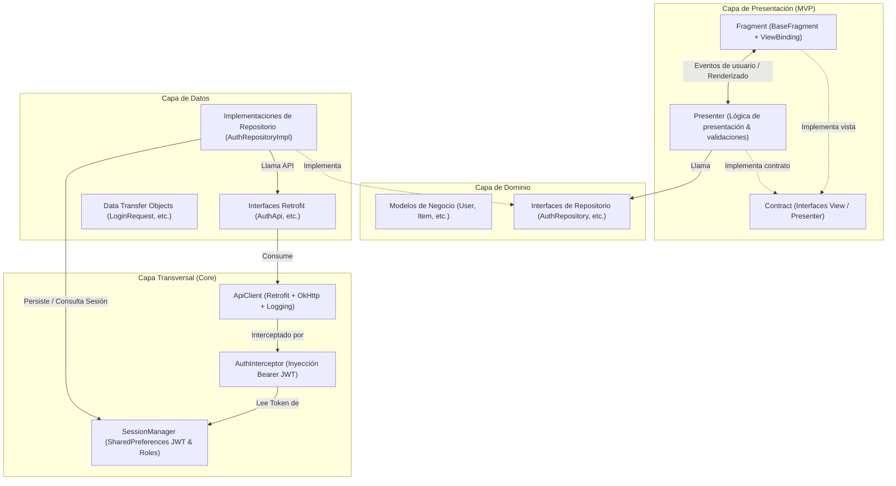
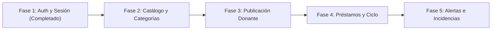

# RedSoporteX - Contexto Técnico, Arquitectura y Hoja de Ruta

> **Fecha de generación:** 4 de Noviembre de 2026  
> **Repositorio Frontend:** [github.com/730XX/RedSoporteX](https://github.com/730XX/RedSoporteX.git)  
> **Repositorio Backend:** [github.com/730XX/RedSoporteBackend](https://github.com/730XX/RedSoporteBackend)  
> **Backend Producción:** `https://redsoportebackend-production.up.railway.app`

---

## 1. Visión General del Proyecto

**RedSoporteX** es una plataforma colaborativa móvil desarrollada para Android orientada a la gestión, préstamo solidario y donación de implementos y ayudas técnicas ortopédicas (sillas de ruedas, andadores, muletas, camas clínicas, etc.).

La plataforma atiende a dos tipos de usuarios principales bajo un modelo colaborativo con control de acceso basado en roles (**RBAC**):
1. **Solicitantes (`ROLE_SOLICITANTE`)**: Personas o familias con requerimientos temporales o permanentes de ayudas técnicas, que buscan en el catálogo, solicitan préstamos por una cantidad estimada de días y levantan alertas de necesidad en caso de escasez.
2. **Donantes (`ROLE_DONANTE`)**: Benefactores o entidades que publican implementos disponibles, gestionan entregas mediante confirmaciones de entrega (*check-in*) y reportan el estado o incidencias al recibir el artículo de vuelta.
3. **Administradores (`ROLE_ADMIN`)**: Supervisión general del sistema y auditoría.

---

## 2. Especificación del Backend (Spring Boot en Railway)

* **Servidor en Producción:** `https://redsoportebackend-production.up.railway.app`
* **Prefijo de Endpoints:** `/api/v1`
* **Mecanismo de Autenticación:** Tokens JWT transmitidos en la cabecera `Authorization: Bearer <token>`.
* **Estructura Estándar de Respuesta:**
  ```json
  {
    "success": true,
    "message": "Mensaje descriptivo",
    "data": { ... }
  }
  ```

### Matriz de Endpoints y Roles

| Módulo | Método | Endpoint | Rol Requerido | Descripción |
| :--- | :---: | :--- | :--- | :--- |
| **Auth** | `POST` | `/api/v1/auth/register` | Público | Registra Donante o Solicitante con datos de contacto y dirección. |
| **Auth** | `POST` | `/api/v1/auth/login` | Público | Retorna JWT token, tipo Bearer y datos del usuario autenticado. |
| **Categorías** | `GET` | `/api/v1/categories` | Público | Catálogo maestro de categorías para filtrado y creación de alertas/items. |
| **Implementos** | `GET` | `/api/v1/items` | Público | Listado de implementos disponibles en catálogo. |
| **Implementos** | `GET` | `/api/v1/items?categoryId={id}` | Público | Filtrado por identificador de categoría. |
| **Implementos** | `GET` | `/api/v1/items/{id}` | Público | Detalle extendido de un implemento específico. |
| **Implementos** | `POST` | `/api/v1/items` | `ROLE_DONANTE` | Publicación de nuevo implemento con estado de conservación. |
| **Préstamos** | `POST` | `/api/v1/lendings` | `ROLE_SOLICITANTE` | Solicitud formal de préstamo de un implemento disponible. |
| **Préstamos** | `GET` | `/api/v1/lendings/mis-prestamos` | Autenticado | Historial y préstamos activos del usuario en sesión. |
| **Préstamos** | `PATCH` | `/api/v1/lendings/{id}/check-in` | `ROLE_DONANTE` | Donante confirma entrega física; préstamo pasa a `ACTIVE`. |
| **Préstamos** | `PATCH` | `/api/v1/lendings/{id}/check-out` | `ROLE_SOLICITANTE` | Solicitante confirma devolución física; préstamo pasa a `RETURNED`. |
| **Alertas** | `POST` | `/api/v1/alerts` | `ROLE_SOLICITANTE` | Crea una alerta de búsqueda por categoría y radio de cobertura. |
| **Alertas** | `GET` | `/api/v1/alerts/mis-alertas` | `ROLE_SOLICITANTE` | Listado de alertas creadas por el usuario. |
| **Alertas** | `PATCH` | `/api/v1/alerts/{id}/cancelar` | `ROLE_SOLICITANTE` | Cancela una alerta activa (`CANCELLED`). |
| **Incidencias** | `POST` | `/api/v1/incidents` | Autenticado | Reporta daños, higiene o demoras vinculadas a un préstamo. |
| **Incidencias** | `GET` | `/api/v1/incidents/lending/{id}` | Autenticado | Lista incidencias de un préstamo. |
| **Incidencias** | `GET` | `/api/v1/incidents/mis-reportes` | Autenticado | Reportes generados por el usuario actual. |

---

## 3. Arquitectura del Frontend Android

El proyecto sigue una combinación rigurosa de **Clean Architecture** y **MVP (Model-View-Presenter)** con **Feature-First**:



### Estructura de Paquetes en el Proyecto

```text
com.example.redsoportex/
├── RedSoporteApp.java             # Clase Application: inicializa sesión y networking
├── MainActivity.java              # Host único de navegación (Single-Activity)
│
├── core/
│   ├── network/
│   │   ├── ApiClient.java         # Cliente Retrofit singleton con timeouts y Gson
│   │   ├── ApiResponse.java       # Mapeo estándar de respuestas del backend
│   │   └── AuthInterceptor.java   # Interceptor OkHttp que inyecta el token Bearer
│   ├── session/
│   │   └── SessionManager.java    # SharedPreferences: JWT, roles y perfil del usuario
│   └── ui/
│       ├── BaseFragment.java      # Abstracción base con ViewBinding libre de leaks
│       ├── BottomNavHelper.java   # Configuración de barra inferior y soporte multi-rol
│       └── CardRenderer.java      # Renderizado reutilizable de tarjetas de implementos
│
├── data/
│   ├── remote/
│   │   ├── api/
│   │   │   └── AuthApi.java       # Definición Retrofit de autenticación
│   │   └── dto/auth/
│   │       ├── LoginRequest.java
│   │       ├── LoginResponse.java
│   │       └── RegisterRequest.java
│   └── repository/
│       └── AuthRepositoryImpl.java# Implementación de repositorio conectada a API y sesión
│
├── domain/
│   ├── model/
│   │   └── User.java              # Entidad pura de usuario
│   └── repository/
│       └── AuthRepository.java    # Interfaz / contrato de repositorio con callbacks
│
└── feature/                       # Módulos organizados por funcionalidad
    ├── auth/                      # Login, Registro y Bienvenida
    ├── catalog/                   # Catálogo de implementos y detalle
    ├── donor/                     # Publicación y listado de donaciones
    ├── lending/                   # Solicitudes y seguimiento de préstamos
    ├── alerts/                    # Alertas de necesidad
    ├── incidents/                 # Reportes y control de incidencias
    └── profile/                   # Perfil de usuario, roles y cierre de sesión
```

---

## 4. Estado Actual de la Implementación

1. **Stack de Networking y Seguridad:**
   - Retrofit 2.11.0, OkHttp 4.12.0 con Logging Interceptor y Gson 2.11.0 agregados y operativos en `app/build.gradle.kts`.
   - Permisos de red `INTERNET` y `ACCESS_NETWORK_STATE` declarados en el manifest.
   - `RedSoporteApp` inicializa `ApiClient` y `SessionManager` en el ciclo de arranque de la aplicación.
2. **Autenticación Completa con Backend:**
   - **Login:** Conectado con `/api/v1/auth/login`. Valida entradas, emite estado de carga, guarda sesión persistente y redirige a la pantalla principal limpiando el backstack.
   - **Registro:** Conectado con `/api/v1/auth/register`. Captura nombre, correo, contraseña, teléfono, rol (`ROLE_DONANTE`/`ROLE_SOLICITANTE`) y dirección con coordenadas predeterminadas.
   - **Auto-Login:** Si hay una sesión activa, el usuario ingresa directo al catálogo sin pasar por la bienvenida.
   - **Perfil y Logout:** El perfil muestra los datos del usuario en sesión (`SessionManager`) y al pulsar "Cerrar sesión" se purgan las credenciales locales.
3. **Control de Versiones:**
   - Repositorio Git inicializado en rama `main`.
   - `.gitignore` pulido para descartar cachés, archivos de construcción y credenciales locales.
   - Primer commit y sincronización remota completados hacia `https://github.com/730XX/RedSoporteX.git`.

---

## 5. Hoja de Ruta / Próximos Pasos

A continuación se detalla el orden recomendado para completar el 100% de la integración:



### Plan de Integración por Fases:

1. **Fase 2 - Catálogo y Categorías:**
   - Crear `CategoryApi` e `ItemApi`.
   - Implementar `ItemRepository` y migrar `CatalogPresenter` y `ItemDetailPresenter` para consumir datos reales de `/api/v1/items` y `/api/v1/categories`.
2. **Fase 3 - Publicación de Donaciones:**
   - Conectar formulario de donante (`donorItemFormFragment`) con `POST /api/v1/items`.
   - Cargar las categorías del backend en el selector desplegable.
3. **Fase 4 - Flujo de Préstamos (`Lendings`):**
   - Conectar solicitud de préstamo (`POST /api/v1/lendings`).
   - Conectar lista de préstamos (`GET /api/v1/lendings/mis-prestamos`).
   - Implementar acciones de `Check-in` (donante) y `Check-out` (solicitante).
4. **Fase 5 - Alertas e Incidencias:**
   - Conectar creación y cancelación de alertas de necesidad (`/api/v1/alerts`).
   - Conectar formulario y listado de reporte de incidencias (`/api/v1/incidents`).
5. **Retiro de `DemoStore`:**
   - Limpiar el mock in-memory una vez que todas las pantallas consuman datos del backend.
